**[리눅스 완전 정복 : 리눅스 목차](https://jhnyang.tistory.com/notice/45)**

아마 마운트라는게 윈도우 운영체제에서는 우리가 실감할 일이 없기 때문에

리눅스를 처음 접하시는 분들은 헷갈릴 수 있는 개념이예요.

오늘은 마운트에 대해서 끄적여보도록 하겠습니다.

글을 일기전 먼저 [사용자 권한 rwx에 대해서 모르는 분은 전 포스팅](https://jhnyang.tistory.com/11)을 읽고 오기 추천해요~

**MOUNT가 뭐야?**

보통 개인 PC나 노트북의 운영체제가 주로 윈도우이기 때문에 윈도우는 다들 익숙하게 알고 계시죠?

요새 점점 사라져가지만 예전에 책을 사면 강의가 들은 CD를 주고는 했죠

음악을 CD로 굽기도 했었고..(몇년지나면 애들은 이걸 모르겠군...마치 내가 늙은거같넴;;)

또는 USB를 꼽으면 내컴퓨터 폴더에 USB파일이 뜨면서 자동으로 연결되죠?!

또는! 외장하드를 꼽아도 :E 이런식으로 폴더가 만들어져요

SSD외에 추가로 하드디스크를 넣어도 :D 폴더가 자동으로 생성되죠!

이렇게 디스크와 같은 물리적인 장치를 특정 위치 즉 디렉터리에 연결시켜주는 것을 마운트라고 합니다

근데 우리는 왜 이런 용어를 몰랐냐!

윈도우에서는 이거를 얘네가 자동으로 해줘요

저렇게 되는거부터가 자동으로 얘네가 해줬기 때문에 CD-ROM을 넣자마자! USB를 꼽자마자! 폴더가 잡히는 거랍니다.

요새는 PnP(Plug and play 플러그 앤 플레이 = 디바이스를 꼽기만 하면 알아서 설정하고 플레이되는..)라는 기능 덕분에 사용자가 직접 해줄필요는 없어요

결국 다 내부에서 마운트 작업이 이뤄지는 것

하지만! 리눅스의 경우 특히 서버 환경의 경우는 PnP 기능이 작동하지 않고 일일이 직접 우리가 연결을 해줘야 합니다.

관리자가 직접 특정 디렉터리에 붙이는 작업을 수행해줘야 해요 --> mount 작업!

**'보조기억장치(HDD, FDD, CD-ROM 등)나 파일 시스템이 다른 디스크를**

**/의 하위 디렉터리로 연결하여 사용 가능하게 해주는 명령어**

**mount**

리눅스를 더 잘 이해하기 위해서는 리눅스의 파일 시스템 구조에 대해서 알아야합니다.

리눅스는 Unix 시스템으로 윈도우와는 다르게 하나의 디렉터리로부터 뻗어지는 single directory tree 구조를 갖고 있습니다.

접근 가능한 모~~든 저장공간의 뿌리가 결국 하나의 디렉터리랑 연결되는 거죠

(참고로 윈도우의 경우 드라이브당 각 하나의 디렉터리 트리 구조를 갖죠 D:드라이브, E:드라이브, C:드라이브 이렇게 분리된거처럼)

그래서 리눅스는 마운팅하면 저런 형식의 파일 경로를 갖지 않고

예를 들어 '/media/cdrom' 이런식으로 /의 하위 경로를 갖습니다.

(Linux FileSystem 리눅스 파일 시스템을 키워드로 검색하면 더 자세한 정보를 습득할 수 있어요~~)

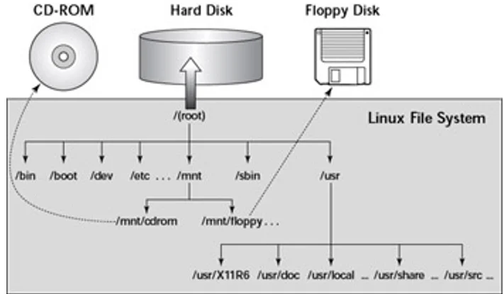

그림으로 보는 리눅스의 파일 시스템 예시~

**MOUNT 명령어**

자 이제 파일 시스템에 대해 대략적으로 이해를 했으면 mount 명령어 사용법을 살펴봅시다.

**사용법**

**\# mount \[option\] \[device\] \[directory\]**

마운트의 주요 옵션은 3가지 입니다.

<table style="border-collapse: collapse; width: 100%;" border="1" width="764"><tbody><tr><td>
&nbsp;옵션
</td><td>&nbsp;내용&nbsp;</td></tr><tr><td>&nbsp;-a</td><td>&nbsp;/etc/fstab에 명시된 파일 시스템을 마운트할 때 쓰이는 옵션입니다.</td></tr><tr><td>&nbsp;-t&nbsp;<i>fs_type</i></td><td>
&nbsp;파일 시스템의 유형을 지정하는 옵션으로 지정하지 않으면 /etc/fstab 파일을 참조합니다.&nbsp;
</td></tr><tr><td rowspan="1">&nbsp;-o 항목</td><td rowspan="1">&nbsp;마운트할 때 추가적인 설정을 적용할 때 사용하는 옵션으로 다수의 조건을 적용할 때는 콤마(,)로 구분하면 됩니다.&nbsp;&nbsp;</td></tr></tbody></table>

\-o주요 항목

<table style="border-collapse: collapse; width: 100%;" border="1" width="764"><tbody><tr><td>
&nbsp; 유형
</td><td>
&nbsp;내용&nbsp;
</td></tr><tr><td>
&nbsp;ro&nbsp;
</td><td>
&nbsp;읽기 전용으로 마운트합니다&nbsp;
</td></tr><tr><td>
&nbsp;rw
</td><td>
&nbsp;읽기 쓰기 모드로 마운트합니다 (기본값으로 설정되어 있습니다.)&nbsp;
</td></tr><tr><td>
&nbsp;remount
</td><td>
&nbsp;해당 파티션을 다시 마운트 합니다. 파티션 정보를 바꾸었을 떄 사용합니다.
</td></tr><tr><td rowspan="1">
&nbsp;loop
</td><td rowspan="1">
&nbsp;loop 디바이스로 마운트 할 때 사용합니다.&nbsp;

&nbsp;CD-ROM 이미지 파일인 iso를 마운트해서 사용할 때 사용합니다.&nbsp;
</td></tr><tr><td rowspan="1">
&nbsp;noatime
</td><td rowspan="1">
&nbsp;파일의 내용을 읽게 되면 access time이 변경되는데 이 옵션을 사용하면 파일이 변경되기 전까지는 Access time이 변경되지 않습니다. 따라서 이 옵션을 사용하게 되면 시스템의 작업을 줄여 성능 향상을 가져옵니다. 노트북에서 사용하면 디스크 접근에 따른 배터리 시간을 늘려줍니다.
</td></tr></tbody></table>

등등

**test**

아무런 옵션 없이 mount 명령어만 실행했을 경우, 다음 그림처럼 현재 시스템에 마운트된 정보를 확인할 수 있습니다.

잘 보면 가로 안에 rw 익숙한 알파벳이 보이죠 [저번 포스팅에서 봤던 파일 권한식](https://jhnyang.tistory.com/11)입니다.

읽기/쓰기 모드로 마운트되어있다는 것

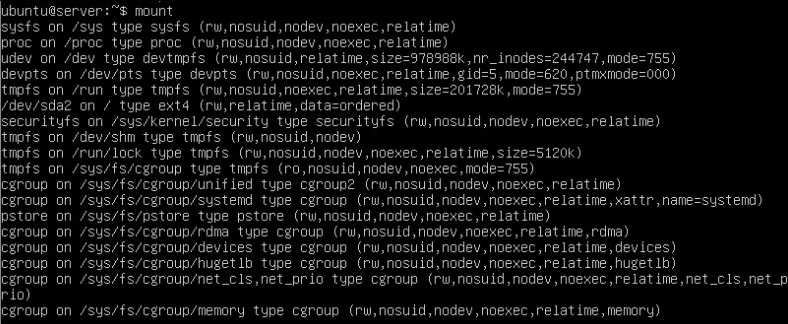

하지만 우리는 직접 디바이스를 디렉터리에 마운팅 할 줄 알아야 하죠

**디스크 직접 마운트 해보기**

디스크 하나를 추가해서 마운트 작업을 해봅시다.

디스크를 추가하기 전에 비교를 위해 disk를 확인해볼까요?

**디스크 파티션을 확인하고 추가 삭제하는 명령**

**fdisk**

fdisk -l 명령어를 쳐줍니다.

여기서 -l옵션은 디스크의 파티션 테이블 정보를 출력하는 옵션이예요

<table style="border-collapse: collapse; width: 100%;" border="1" width="764"><tbody><tr><td>
&nbsp;옵션&nbsp;
</td><td>
&nbsp;내용&nbsp;
</td></tr><tr><td>
&nbsp;-l&nbsp;&nbsp;
</td><td>
&nbsp;현재 디스크의 파티션 테이블 정보를 출력합니다&nbsp;
</td></tr><tr><td>
&nbsp;-s&nbsp;<i>partition&nbsp;</i>
</td><td>
특정 파티션의 크기를 출력합니다 (단위는 block)&nbsp;
</td></tr></tbody></table>

그러면 아래 그림과 같이 정보를 쭈우욱 출력해줄겁니다

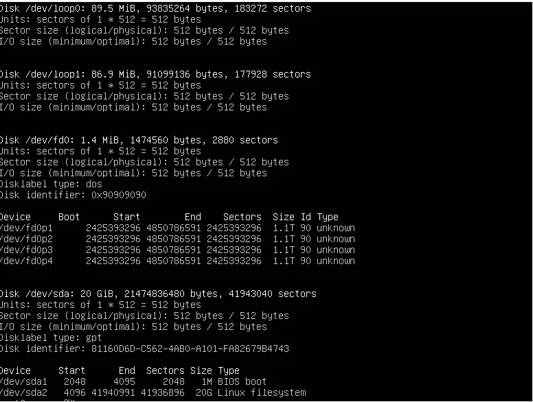

디스크 추가하러 가기~

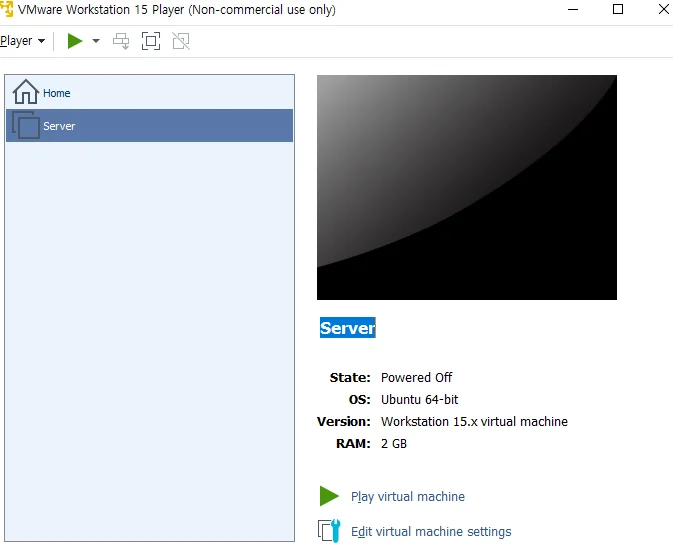

디스크 추가를 위해 Edit virtual machine settings 클릭

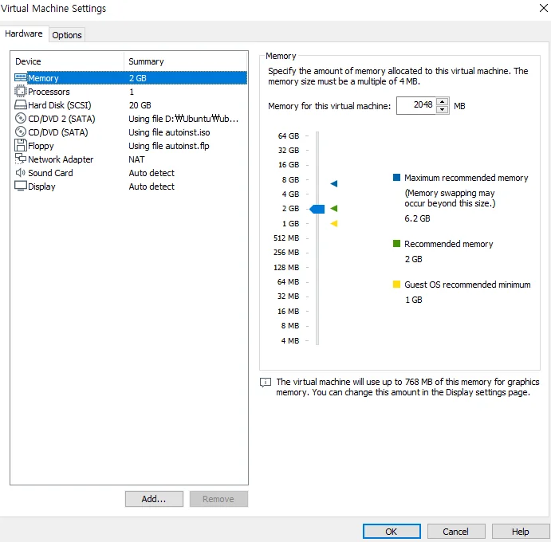

여기서 Add해준 후 harddisk 클릭 --> next --> SCSI -> next --> create new virtual disk --> next~~

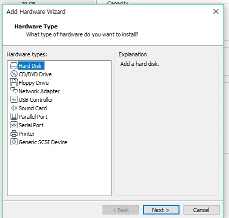

우리는 마운트를 위한 테스트용으로만 쓸거니까 용량은 작게 2G 잡아줄게요

용량도 조그마니까 single file로

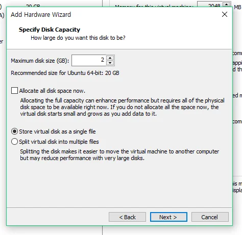

이름은 걍 지어주는대로 후 finish

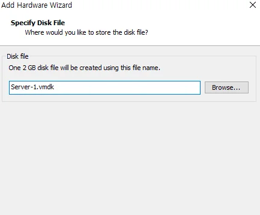

고럼 이렇게 새로 생긴 new hard disk 2기가짜리를 확인할 수 있습니다.

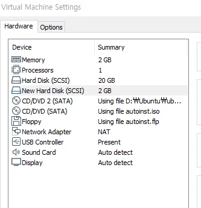

다시 쉘로 돌아가서 fdisk -l 명령어를 수행시켜볼까요?

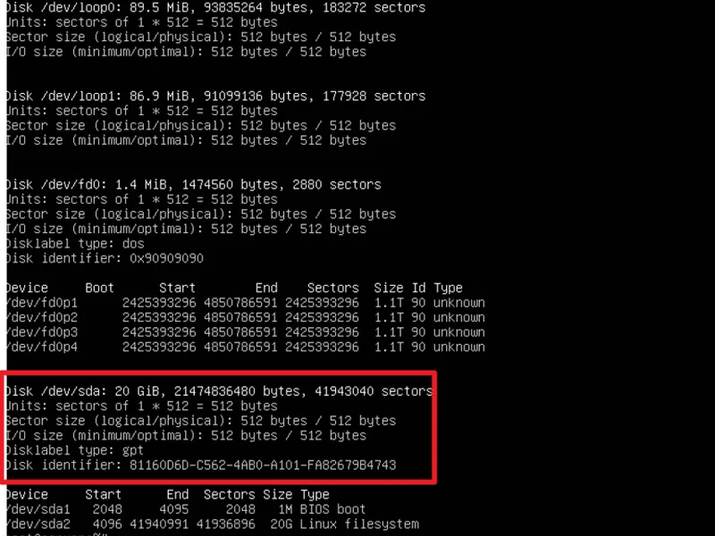

처음에 이렇게 20G짜리 디스크밖에 보이지 않았던 게

디스크 추가 후에는 아래처럼 20G가와 우리가 나중에 추가해줬던 2G짜리까지 추가된 것을 알 수 있어요

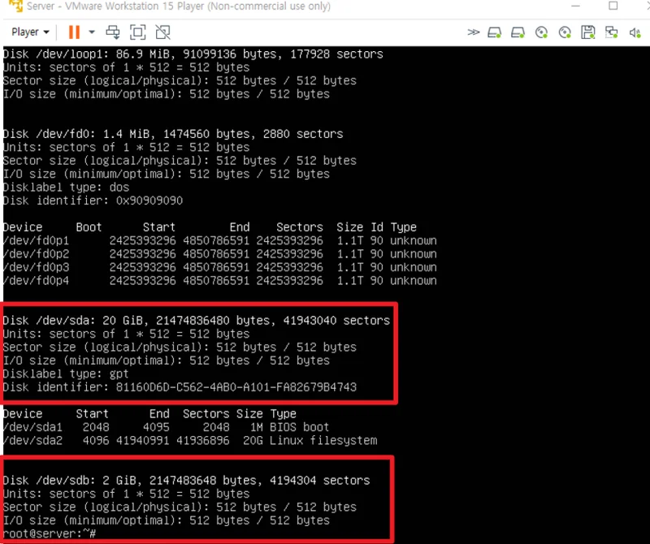

디스크가 제대로 추가가 된 것을 확인했으니

마운트 정보를 확인해볼까요?

**현재 마운트된 디스크 정보 출력**

**df**

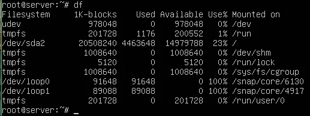

디스크가 추가되었는데도 sdb 마운트 정보를 찾을 수 없네요

디렉터리를 만들어서 우리 하드디스크와 연결해주면 됩니다! (이것이 마운트니까)

**파티션 설정**

사실 마운팅을 하기 전에 우리가 추가하는게 디스크이기때문에 하드디스크 영역인 파티셔닝 설정과 포맷 작업을 해줘야 해요.

fdisk를 통해서 디스크를 확인할 수도 있지만 파티션을 추가해줄 수도 있어요.

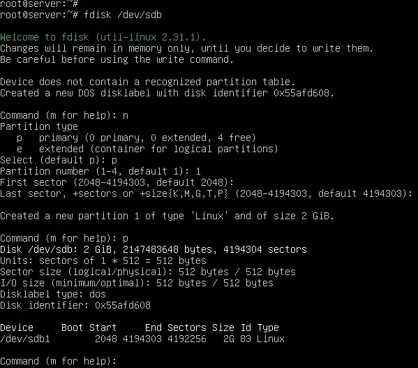

fdisk /dev/sdb 

dev/sdb는 새로 추가한 하드디스크 위치예요

fdisk /dev/sdb 엔터 치면 

거기서 작업할 명령어를 치라고 나옵니다

그럼 fdisk 실행 시 주요 명령이 뭐가 있는지 알아볼까요~~

<table style="border-collapse: collapse; width: 100%;" border="1" width="605"><tbody><tr><td>
&nbsp;주요 명령
</td><td>
&nbsp;내용&nbsp;
</td></tr><tr><td>
&nbsp;p&nbsp;
</td><td>
&nbsp;현재 디스크의 정보를 출력합니다&nbsp;
</td></tr><tr><td>
d
</td><td>
&nbsp;파티션을 삭제합니다 delete의 약자겠죠?&nbsp;
</td></tr><tr><td>
&nbsp;n
</td><td>
&nbsp;new~ 파티션을 새롭게 생성하는 것&nbsp;
</td></tr><tr><td>
&nbsp;t&nbsp;
</td><td>
&nbsp;파티션의 속성을 변경합니다&nbsp;
</td></tr><tr><td rowspan="1">&nbsp;w</td><td rowspan="1">
&nbsp;변경된 파티션의 정보를 저장하고 종료합니다
</td></tr><tr><td rowspan="1">
&nbsp;q
</td><td rowspan="1">
&nbsp;변경된 파티션의 정보를 저장하지 않고 종료합니다.&nbsp;
</td></tr></tbody></table>

1\. 파티션을 생성할 거니까 n을 눌러줬어요

2\. 그러면 그림처럼 파티션이 extended인지 primary 파티션인지 선택하라고 나옵니다 굳이 확장필요 없으니 p입력

3\. 파티션 숫자로는 default인 1을 입력해줍시다.

4 ~5 첫 섹터와 마지막 섹터를 적어달라고 나오는데 엔터를 입력하면 기본값으로 됩니다 (섹터가 뭔지 궁금하시면 하드디스크 구조를 찾아보시면 됩니다. 일단은 그냥 넘어가도 상관 없어요)

이렇게 하면 파티션이 완성됩니다!

p명령어를 입력하면

파티션이 잘 생성되어 sdb1 이렇게 뒤에 숫자 1이 붙은 것을 볼 수 있어요

w로 파티션을 저장해줍시다.

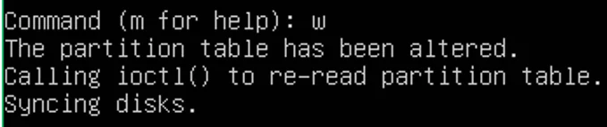

**포맷 하기**

ext4방식으로 포맷해줄거예요

ext4는 파일 시스템이라고 생각하면 됩니다.

**새로운 파일 시스템을 만드는 명령**

**mkfs (make filesystem)**

**\# mkfs \[-t fs\_type\] \[option\] 장치명**

mkfs 명령어를 이용해서 /dev/sdb1 장치에다가 파일 시스템 유형을 지정해줍시다.

mkfs -t ext4 /dev/sdb1

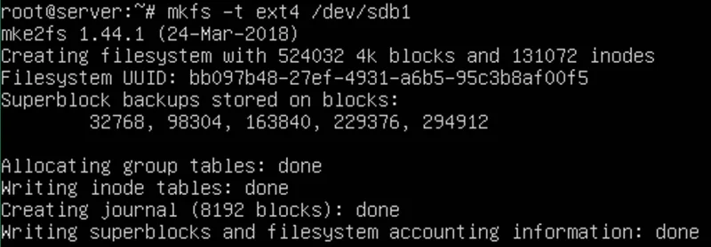

**마운트 작업!**

드디어 ㅠㅠ 마운트하기

이 마운트를 하기 위해 앞의 별의 별 작업을 다 해줬죠 .ㅎㅎ

물론 책으로만 이해하고 명령어를 외워도 좋지만

아무래도 해보는게 암기는 빠르니까요

디바이스를 연결시켜줄 디렉터리를 하나 만들어줍시다.

저는 그냥 drv라고 했으요

mount /dev/sdb1 /drv

\--> /dev/sdb1 디바이스를 drv 디렉터리에 마운트 (매핑) 시키겠다!

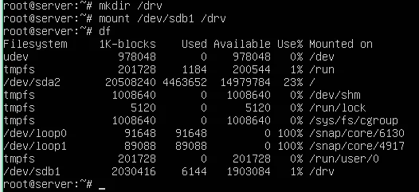

잘 됐나 확인을 위해 df 명령어를 입력하니

맨 마지막에 /dev/sdb1 ~~~ 라인에서 전에 없던 마운트 정보가 입력된 것을 확인할 수 있습니다.
